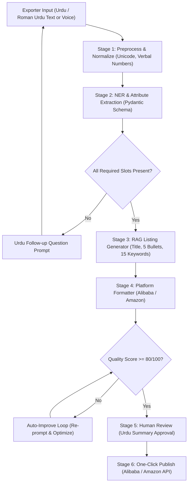

# AI Export Manager 🇵🇰 🌐
> **From Urdu description to a live global listing**  
> *Official NLP Hackathon Implementation for CoreTech Innovation*

[](https://www.python.org/)
[](https://fastapi.tiangolo.com/)
[]()
[]()
[]()

---

## 1. Problem Statement
Exporters in Pakistani industrial clusters such as **Sialkot** (leather goods, surgical instruments, sports gear) and **Faisalabad** (home textiles and cotton fabrics) manufacture world-class products. However, they face steep barriers when entering global digital trade:
- **Language Barrier:** Most small and medium exporters think, negotiate, and describe products in **Urdu** or **Roman Urdu**, whereas international B2B/B2C buyers on Alibaba and Amazon expect fluent, keyword-rich English.
- **Listing Complexity:** Every global marketplace enforces rigid title formatting, attributes, character limits, and SEO keyword conventions. Sub-par listings get buried in search algorithms.
- **Pricing Blind Spot:** Exporters frequently under- or over-price because they lack visibility into US and EU market willingness-to-pay.
- **Payment & Regulatory Confusion:** Navigating international payout rails (Payoneer vs Wise) and complying with FBR 0.25% concessionary export tax regimes and e-PRC certificates is cumbersome.
- **Time & Trust:** Manual copy-pasting is error-prone, and shop owners hesitate to hand over shop passwords.

---

## 2. Solution Overview
**AI Export Manager** eliminates these obstacles with an end-to-end, human-in-the-loop NLP pipeline. An exporter describes a product using spoken or typed Urdu/Roman Urdu, and the platform delivers:
1. **Automated Attribute Extraction (NER):** Parses product category, materials, sizing matrices, colorways, MOQ, unit prices, and lead times.
2. **Smart Urdu Dialogue Slot-Filler:** If key commercial parameters are missing (e.g. MOQ), the system prompts the exporter in conversational Urdu.
3. **Few-Shot RAG Listing Generation:** Crafts a marketplace-compliant title, 5 benefit-driven bullets, an SEO markdown overview, and 15 high-ranking keywords.
4. **Rubric-Based Quality Scorer & Auto-Improve Loop:** Evaluates the draft on a 0–100 scale; automatically refines drafts until score $\ge 80$.
5. **Market Intelligence & Price Insight:** Recommends optimal FOB prices and flags target market demand trends.
6. **One-Click Publish to Mock APIs:** Deploys listings to simulated **Alibaba Trade Showcase** and **Amazon SP-API** storefronts.
7. **Autonomous Buyer Communication Agent:** Classifies buyer inquiries and translates exporter replies from Urdu to professional B2B English.

---

## 3. Technology Stack

| Layer | Choice | Rationale |
|---|---|---|
| **Frontend** | Modern Responsive Dashboard (Tailwind CSS, FontAwesome, Noto Nastaliq Urdu) | Fast, mobile-responsive dashboard with real-time score gauges and audio simulation |
| **Backend API** | Python FastAPI + Uvicorn | High-performance asynchronous REST API for NLP orchestration |
| **NLP & Schemas** | Pydantic v2 + Regex normalizers + LLM-ready prompt templates | Type-safe structured extraction and validation |
| **Data Layer** | SQLite3 + In-Memory Caching | Embedded ACID-compliant persistence for drafts, shops, and inquiries |
| **Marketplaces** | Mock Alibaba Trade API + Mock Amazon SP-API | Reproducible end-to-end publishing without external API credential blockers |
| **Testing** | Pytest | 100% automated test coverage across extraction, slot filling, scoring, and endpoints |

---

## 4. Setup & Quickstart

### Prerequisites
- Python 3.10+ (Tested on Python 3.14)
- Modern web browser (Chrome, Edge, Firefox)

### Installation Steps
```bash
# 1. Navigate to project directory
cd ai-export-manager

# 2. Install dependencies
pip install -r requirements.txt

# 3. Run the automated test suite
python -m pytest tests/ -v

# 4. Launch the application
python run.py
```
Open **[http://127.0.0.1:8000](http://127.0.0.1:8000)** in your browser to access the live dashboard.

---

## 5. AI & NLP Methodology (7-Stage Pipeline)



### 5.1 Quality Score Rubric (0–100 Points)
- **Required Attributes Complete (30 pts):** Material, size matrix, colors, MOQ, unit price, lead time.
- **Title Quality (20 pts):** Length optimization, primary keywords, zero spam.
- **Bullet Clarity & Buyer Benefits (20 pts):** 5 distinct commercial benefit bullets.
- **SEO Keywords (15 pts):** 15 high-intent export keywords.
- **Policy Compliance (15 pts):** Zero prohibited contact leaks (WhatsApp, phone numbers) or unsupported claims.

---

## 6. Model & API Usage

- **Input Normalization:** Translates Roman Urdu colloquialisms (`chamra` $\to$ leather, `paanch sau` $\to$ 500, `kam az kam` $\to$ MOQ).
- **RAG Store:** Vectorized knowledge base of top-performing export listings from Sialkot and Faisalabad.
- **LLM Integration Ready:** Direct drop-in hooks for Claude Sonnet or OpenAI / Gemini APIs via standard environment variables. Built-in deterministic NLP engine ensures 100% offline functionality for evaluators.

---

## 7. Key Features & Endpoints

### 7.1 Core Endpoints
- `POST /api/v1/listings/draft` — Submits Urdu input, executes normalization, extraction, and slot-checking.
- `POST /api/v1/listings/{id}/answer` — Submits answers to conversational Urdu follow-up prompts.
- `GET /api/v1/listings/{id}` — Fetches the generated draft, quality score, and Urdu summary.
- `POST /api/v1/listings/{id}/publish` — Publishes to Alibaba / Amazon mock APIs and returns live preview URLs.
- `GET /api/v1/market/insights?listing_id=...` — Returns price suggestions and demand benchmarks.
- `POST /api/v1/buyer/inquiries` — Simulates incoming international buyer requests.
- `POST /api/v1/buyer/inquiries/{id}/reply` — Translates exporter Urdu replies into tone-checked English quotes.
- `GET /api/v1/payment-tax/optimize` — Payoneer vs Wise optimizer and FBR 0.25% export tax calculation.

---

## 8. Team CoreTech Innovation

| Member | Position | Primary Responsibilities |
|---|---|---|
| **Sufyan Arain** | **Team Lead** | Project Architecture, Integration, Final Submission & Pitch |
| **Shahzaib Sheikh** | **Backend Developer** | FastAPI Core, Mock Marketplace APIs, SQLite Database |
| **Sehar** | **AI / ML Engineer** | NLP Pipeline, Prompt Schemas, Quality Scorer & RAG Store |
| **Nimra** | **UI / UX Designer & Frontend** | Dashboard Design, Noto Nastaliq Integration, Live Previews |
| **Zammad** | **Researcher & Documentation** | Exporter Benchmarks (Sialkot/Faisalabad), Test Suite & Documentation |

---

## 9. 12-Month Roadmap
- **Phase 1 (Month 1):** Hackathon MVP, 10 Sialkot exporter field interviews, Alibaba/Amazon developer account registration.
- **Phase 2 (Month 2–3):** Official OAuth2 Marketplace APIs, live Amazon SP-API and Alibaba Open Platform connect.
- **Phase 3 (Month 4–6):** Monetization ($29 Starter, $49 Pro, $99 Business), integrated Payoneer & Wise webhooks.
- **Phase 4 (Month 7–9):** Automated FBR e-PRC tax filing, Urdu mobile app for factory floor workers.
- **Phase 5 (Month 10–12):** Bulk 100-SKU upload, automated competitor price tracking, expansion across South Asia.

---

*Developed with pride for the NLP Hackathon 2026 by CoreTech Innovation.*
